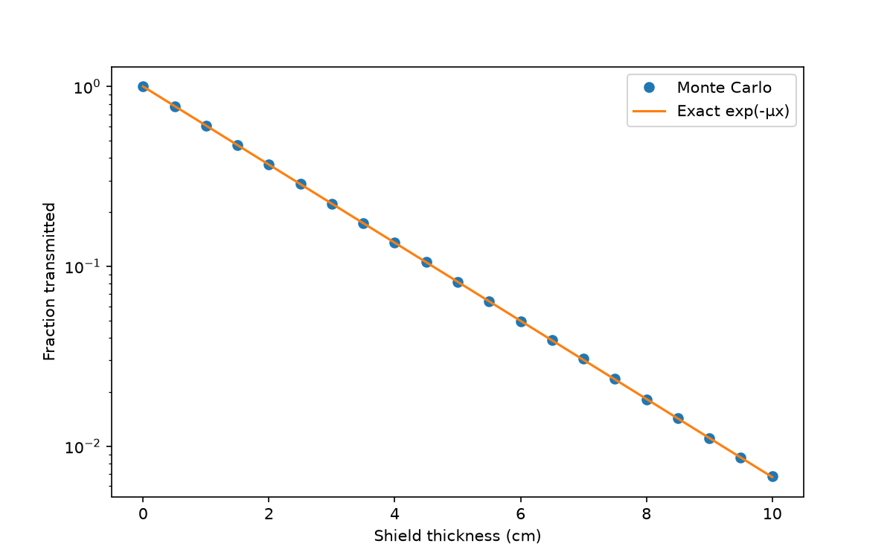
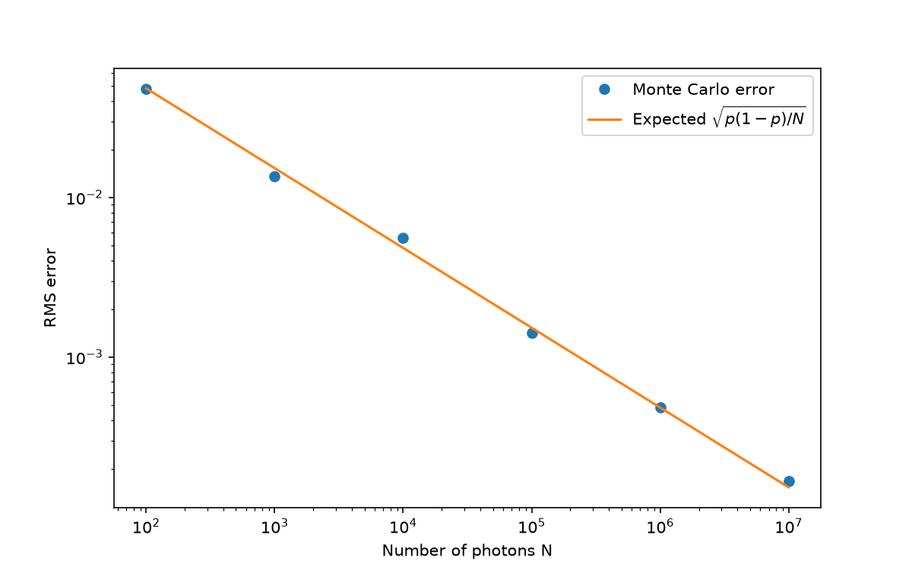

# Monte Carlo Photon Shielding

<!-- DRAFT: rewrite each section in your own words before pushing. Delete this comment when done. -->

A Monte Carlo simulation of gamma-ray photons passing through a shielding slab. The simulation is written in C++, with analysis and plots in Python.

## What it does

<!-- In your words: what happens to a photon in a shield, and why simulate it instead of using the formula? -->

Each photon travels a random distance before it interacts with the material. The distance is sampled from an exponential distribution:

x = −ln(r) / μ, where r is a uniform random number in (0, 1] and μ is the attenuation coefficient.

If the photon travels further than the slab is thick, it is transmitted. Firing a million photons and counting how many get through gives the transmitted fraction, which should match the Beer–Lambert law, exp(−μx).

## Results

### 1. Transmission vs thickness



<!-- In your words: what does the plot show? Why is it a straight line on a log scale? -->

The simulated transmission (1 million photons per thickness, μ = 0.5 cm⁻¹) matches exp(−μx) from 0 to 10 cm, over nearly three orders of magnitude.

### 2. Convergence



<!-- In your words: how do you know the gap is statistics, not a bug? -->

Each transmission count is a binomial process, so the expected statistical error is σ = √(p(1−p)/N). I ran each photon count 50 times and took the RMS error. It follows the predicted 1/√N scaling from N = 100 to N = 10,000,000.

## How to run

```
# Simulation (C++)
clang++ -std=c++17 -O2 src/main.cpp -o mc && ./mc
clang++ -std=c++17 -O2 src/convergence.cpp -o conv && ./conv

# Plots (Python)
python3 analysis/plot.py
python3 analysis/convergence_plot.py
```

Run from the project folder. Requires a C++17 compiler and Python with NumPy, pandas and Matplotlib.

## Structure

- `src/main.cpp`: transmission vs thickness sweep
- `src/convergence.cpp`: error vs number of photons, repeated runs
- `analysis/`: Python plotting scripts
- `results/`: CSV output and figures

## Next steps

<!-- Pick what you'd genuinely do next. Ideas: -->
- Compare against my own gamma-ray attenuation measurements through lead
- Add Compton scattering, so photons can change direction and lose energy
- Multi-layer shields of different materials
